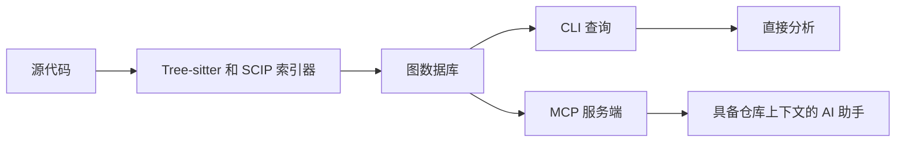
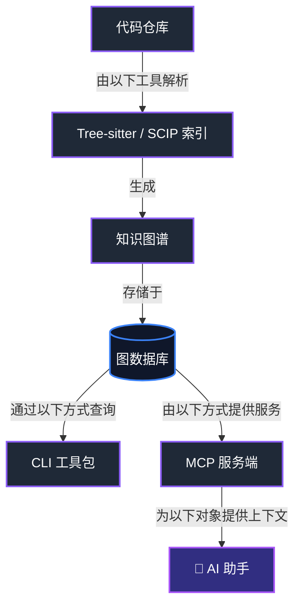

# 🏗️ CodeGraphContext (CGC)

**将代码仓库转换为 AI 智能体可查询的图。**

🌐 **语言 (Languages):**
- 🇬🇧 [English](../../README.md)
- 🇨🇳 [中文](README.zh-CN.md)
- 🇰🇷 [한국어](README.kor.md)
- 🇺🇦 [Українська](README.uk.md)
- 🇷🇺 [Русский](README.ru-RU.md)
- 🇯🇵 [日本語](README.ja.md)
- 🇮🇳 [தமிழ்](README.ta.md)
- 🇪🇸 Español (即将推出)

🌍 **在 [GitHub Issues](https://github.com/CodeGraphContext/CodeGraphContext/issues) 上提交 Issue 和 PR，帮助我们将 CodeGraphContext 翻译成你的语言！**

<p align="center">
  <br>
  <b>连接深层代码图与 AI 上下文之间的鸿沟。</b>
  <br><br>
  <a href="https://pypi.org/project/codegraphcontext/">
    
  </a>
  <a href="https://pypi.org/project/codegraphcontext/">
    
  </a>
  <a href="../../LICENSE">
    
  </a>
  
  <a href="https://discord.gg/VCwUdCnn">
    
  </a>
  <br><br>
  <a href="https://github.com/CodeGraphContext/CodeGraphContext/stargazers">
    
  </a>
  <a href="https://github.com/CodeGraphContext/CodeGraphContext/network/members">
    
  </a>
  <a href="https://github.com/CodeGraphContext/CodeGraphContext/issues">
    
  </a>
  <a href="https://github.com/CodeGraphContext/CodeGraphContext/pulls">
    
  </a>
  <a href="https://github.com/CodeGraphContext/CodeGraphContext/graphs/contributors">
    
  </a>
<br><br>
  <a href="https://github.com/CodeGraphContext/CodeGraphContext/actions/workflows/test.yml">
    
  </a>
  <a href="https://github.com/CodeGraphContext/CodeGraphContext/actions/workflows/e2e-tests.yml">
    
  </a>
  <a href="http://codegraphcontext.vercel.app/">
    
  </a>
  <a href="https://codegraphcontext.vercel.app/">
    
  </a>
  <a href="https://youtu.be/KYYSdxhg1xU">
    
  </a>
</p>


这是一个强大的 **MCP 服务端** 和 **CLI 工具包**，它将本地代码索引到图数据库中，为 AI 助手和开发者提供上下文信息。你可以将其作为独立的 CLI 进行全面的代码分析，或者通过 MCP 将其连接到你最喜欢的 AI IDE，实现 AI 驱动的代码理解。

---

## 📍 快速导航
* [🚀 快速入门](#-快速入门) 
* [📋 先决条件](#-先决条件)
* [🏃 如何在本地运行项目](#-如何在本地运行项目)
* [🌐 支持的编程语言](#支持的编程语言) 
* [🛠️ CLI 工具包](#cli-工具包模式) 
* [🤖 MCP 服务端](#-mcp-服务端模式) 
* [🗄️ 数据库选项](#数据库选项)
* [🔬 SCIP 索引（可选）](#scip-索引可选)

---

## ✨ 体验 CGC


### 👨🏻‍💻 安装与 CLI
> 使用 pip 在几秒钟内完成安装，解锁强大的代码图分析 CLI。


### 🛠️ 秒级索引
> CLI 智能解析 tree-sitter 节点以构建代码图。


### 🤖 赋能你的 AI 助手
> 使用自然语言通过 MCP 查询复杂的调用链。


---

## 为什么选择 CodeGraphContext？

CodeGraphContext 专为纯文本搜索不再够用的时刻而构建。它将仓库转换为由文件、符号、调用、继承、导入和关系组成的图，让你无需在多个工具之间来回切换，就能从"它定义在哪里？"进一步回答"它究竟是如何连接的？"



### 一目了然的对比

| 方案 | 最适合 | 权衡 |
| --- | --- | --- |
| `grep` / 文件搜索 | 精确字符串查找 | 会遗漏关系和代码结构 |
| 基于代码块的 RAG | 自然语言检索 | 可能丢失符号级精度 |
| CodeGraphContext | 仓库级推理 | 需要额外的索引步骤 |

### 常见用例

- 跨文件和跨包追踪调用链。
- 理解类层次结构、导入关系和模块边界。
- 发现死代码、热点和意外的依赖关系。
- 为 AI 助手提供与维护者相同的结构化上下文。

### 常见问题 (FAQ)

- **我需要远程服务吗？** 不需要。CGC 可以在本地使用嵌入式后端，也可以在你需要时连接外部图数据库。
- **它只支持一种语言吗？** 不是。它支持多种主流语言，并且仍在持续扩展。
- **可以和 AI 助手一起使用吗？** 可以。这正是 MCP 服务端存在的主要原因之一。

---

## 项目详情
- **版本:** 0.5.1
- **作者:** Shashank Shekhar Singh <shashankshekharsingh1205@gmail.com>
- **许可证:** MIT License (详见 [LICENSE](../../LICENSE))
- **网站:** [CodeGraphContext](http://codegraphcontext.vercel.app/)

---

## 👨‍💻 维护者
**CodeGraphContext** 由以下人员创建并积极维护：

**Shashank Shekhar Singh**  
- 📧 邮箱: [shashankshekharsingh1205@gmail.com](mailto:shashankshekharsingh1205@gmail.com)
- 🐙 GitHub: [@Shashankss1205](https://github.com/Shashankss1205)
- 🔗 LinkedIn: [Shashank Shekhar Singh](https://www.linkedin.com/in/shashank-shekhar-singh-a67282228/)
- 🌐 网站: [codegraphcontext.vercel.app](https://codegraphcontext.vercel.app/)

*非常欢迎贡献和反馈！如有任何疑问、建议或合作机会，请随时联系。*

---

## Star 历史
[Star 历史图表 ↗](https://www.star-history.com/#CodeGraphContext/CodeGraphContext&Date)
<!-- 内联图表暂时移除：api.star-history.com 目前会渲染
     "GitHub restricted access to star data" 而不是图表
     （GitHub 侧限制，参见 PR #1642）。待官方服务恢复后
     再恢复图片：
     [](https://www.star-history.com/#CodeGraphContext/CodeGraphContext&Date) -->

---

## 功能特性
-   **代码索引:** 分析代码并构建其组件的知识图谱。
-   **关系分析:** 查询调用者、被调用者、类层次结构、调用链等。
-   **预索引包:** 使用 `.cgc` 包即时加载知名仓库 - 无需索引！([了解更多](../../docs/docs/guides/bundles.md))
-   **实时文件监控:** 监控目录更改并实时自动更新代码图 (`cgc watch`)。
-   **交互式设置:** 用户友好的命令行向导，轻松完成设置。
-   **双重模式:** 既可以作为开发者的独立 **CLI 工具包**，也可以作为 AI 智能体的 **MCP 服务端**。
-   **多语言支持:** 全面支持 23 种编程语言。
-   **灵活的数据库后端:** FalkorDB Lite（默认）、KuzuDB、LadybugDB、FalkorDB Remote、Nornic DB 或 Neo4j（通过 Docker/原生支持所有平台）。


---

## 🏗️ 架构与工作流

CodeGraphContext 解析你的源代码并构建全面的知识图谱。该图可以直接通过 CLI 工具包查询，也可以通过 MCP 服务端提供给 AI 助手。



---

## 支持的编程语言

CodeGraphContext 为以下语言提供全面的解析和分析：

| | 语言 | | 语言 | | 语言 |
| :--- | :--- | :--- | :--- | :--- | :--- |
| 🐍 | **Python** | 📜 | **JavaScript** | 🔷 | **TypeScript** |
| ☕ | **Java** | 🔵 | **C** | ➕ | **C++** |
| #️⃣ | **C#** | 🐹 | **Go** | 🦀 | **Rust** |
| 💎 | **Ruby** | 🐘 | **PHP** | 🍎 | **Swift** |
| 🎨 | **Kotlin** | 🎯 | **Dart** | 🐪 | **Perl** |
| 🌙 | **Lua** | 🚀 | **Scala** | λ | **Haskell** |
| 💧 | **Elixir** | 📜 | **Emacs Lisp (elisp)** | 🌐 | **HTML** |
| 🎨 | **CSS** | ⚛️ | **TSX** | ⛓️ | **Solidity** |

每个语言解析器都会提取函数、类、方法、参数、继承关系、函数调用和导入，以构建全面的代码图。

**Solidity 说明：** `.sol` 通过 `tree-sitter-language-pack` 使用 Tree-sitter（不使用 SCIP）。支持 Foundry remappings、modifier 调用、`using Lib for T`，并将 `emit` / 自定义错误 `revert` 记录为 CALLS。参见 `docs/docs/contributing_languages.md` § Solidity。

**Kotlin 说明：** 注解会作为 `decorators` 记录在函数和类上，并保留其参数（`@Preview(showBackground = true)`）。这使得 `find_dead_code` 的 `exclude_decorated_with` 可用于 Kotlin 和 Android 代码库 —— 例如排除 `Composable`、`Preview`、`Test` 和 `Provides`。该过滤器匹配的是函数，因此类级注解不会影响它。接口、对象、构造函数、参数和属性上的注解目前尚未记录。

---

## 数据库选项

CodeGraphContext 支持多种图数据库后端以适应你的环境：

| 特性 | KuzuDB | LadybugDB | FalkorDB Lite | Neo4j / Nornic DB |
| :--- | :--- | :--- | :--- | :--- |
| **典型默认值** | FalkorDB Lite 不可用时的跨平台回退方案 | 可选嵌入式后端 | **Unix 上的默认值**（Python 3.12+，且已安装 `falkordblite` 时） | 通过 `cgc config db` 显式配置时 |
| **设置** | 零配置 / 嵌入式 | 零配置 / 嵌入式 | 零配置 / 进程内 | Docker / 外部 |
| **平台** | **所有平台（Windows 原生、macOS、Linux）** | **所有平台（Windows 原生、macOS、Linux）** | 仅限 Unix（Linux/macOS/WSL） | 所有平台 |
| **用例** | 桌面、IDE、本地开发 | 自定义研究项目 | 专门的 Unix 开发 | 企业、大规模图 |
| **要求**| `pip install kuzu` | `pip install ladybug` | `pip install falkordblite` | Neo4j Server / Docker / Nornic Cloud |
| **速度** | ⚡ 极快 | ⚡ 快速 | 🚀 可扩展 | 🌐 依赖网络 |
| **持久化**| 是（保存至磁盘） | 是（保存至磁盘） | 是（保存至磁盘） | 是（服务端） |

嵌入式 KuzuDB/LadybugDB 默认使用 **4 GiB** 缓冲池（`CGC_EMBEDDED_BUFFER_POOL_MB`）。可将该环境变量设置为其他 MiB 值，或设置为 `0` 以使用库默认值（约系统内存的 80%）。

---

## SCIP 索引（可选）

当 CGC 配置（`~/.codegraphcontext/.env`）中设置 `SCIP_INDEXER=true` 时，部分语言会使用外部 **SCIP** 索引器，从而获得比仅依赖 Tree-sitter 启发式更准确的调用和继承信息。

**C 和 C++** 使用 **scip-clang**，它需要 **`compile_commands.json`** 文件（[JSON 编译数据库](https://clang.llvm.org/docs/JSONCompilationDatabase.html)）：每个翻译单元一条记录，包含真实的编译器命令（include 路径、`-D` 定义、`-std` 等）。没有该文件时，scip-clang 无法运行；CGC 会记录一条警告，并对该仓库**回退到 Tree-sitter**。生成该文件的常见方式：使用带 `-DCMAKE_EXPORT_COMPILE_COMMANDS=ON` 的 **CMake**，或用 **[Bear](https://github.com/rizsotto/Bear)** 包装真实构建（例如 `bear -- make`）。CGC 还会在 `build/` 和 `cmake-build-*/` 下查找该文件名。

**C#** 使用 **scip-dotnet**（Roslyn）；你需要正常的 **`.csproj` / `.sln`** 并成功执行 restore —— 不需要 `compile_commands.json`。

SCIP **与你使用哪种图数据库无关**（Kuzu、Neo4j 等）；同一个标志适用于所有后端。

---

## 谁在用
CodeGraphContext 已经吸引了开发者和项目在以下方面的探索：

- **AI 助手中的静态代码分析**
- **项目的图化可视化**
- **死代码和复杂度检测**

_如果你正在项目中使用 CodeGraphContext，欢迎提交 PR 并添加到这里！ 🚀_

---

## 依赖

- `neo4j>=5.15.0`
- `watchdog>=3.0.0`
- `stdlibs>=2023.11.18`
- `typer>=0.9.0`
- `rich>=13.7.0`
- `inquirerpy>=0.3.4`
- `python-dotenv>=1.0.0`
- `tree-sitter>=0.24.0,<0.26.0`
- `tree-sitter-language-pack>=1.6,<2.0`
- `pyyaml`
- `pathspec>=0.12.1`
- `falkordb>=1.0,<1.6`
- `falkordblite>=0.7,<0.10`（仅 Unix，Python 3.12+）
- `kuzu`（KuzuDB 引擎）
- `fastapi>=0.100.0`
- `uvicorn>=0.22.0`
- `requests>=2.28.0`
- `protobuf>=3.20,<3.21`

**注意：** 支持 Python 3.10-3.14。

---

### 🚀 快速入门

1.  **安装工具包：**
    ```bash
    pip install codegraphcontext
    ```

2.  **故障排除（找不到命令）：**
    如果找不到 `codegraphcontext` 命令，请运行以下一行修复：
    ```bash
    curl -sSL https://raw.githubusercontent.com/CodeGraphContext/CodeGraphContext/main/scripts/post_install_fix.sh | bash
    ```

3.  **数据库设置（自动）：**
    CodeGraphContext 默认使用嵌入式图数据库。
    - **FalkorDB Lite：** 默认后端。
    - **KuzuDB：** 跨平台嵌入式后端。
    - **Neo4j：** 运行 `codegraphcontext neo4j setup` 以使用外部服务器。

### 🧪 本地开发环境搭建

如果你想从本地克隆运行 CodeGraphContext 并贡献改动，请使用可编辑安装：

```bash
git clone https://github.com/CodeGraphContext/CodeGraphContext.git
cd CodeGraphContext
python -m venv .venv
source .venv/bin/activate
pip install -e ".[dev]"
```

然后验证安装并试用本地命令：

```bash
cgc --help
cgc doctor
cgc index .
cgc analyze callers main
```

如需进行 MCP 服务端开发，请完成以下设置：

```bash
cgc mcp setup
cgc mcp start
```

如果你只是安装已发布的包，`pip install codegraphcontext` 就足够了。如果你在开发解析器密集型功能，并且还需要可选的解析依赖，请使用 `pip install -e ".[dev,parsing]"` 安装。

---

## 🐳 Docker（无需 Python）

无需安装 Python 即可运行 CodeGraphContext —— 拉取镜像并开始索引：

### 快速开始
```bash
# 拉取最新镜像
docker pull codegraphcontext/codegraphcontext:latest

# 索引当前目录
docker run --rm -v "$(pwd):/workspace" codegraphcontext/codegraphcontext cgc index .

# 列出已索引的仓库
docker run --rm -v cgc-data:/home/cgc/.codegraphcontext \
    codegraphcontext/codegraphcontext cgc list

# 交互式 shell
docker run -it --rm -v "$(pwd):/workspace" \
    -v cgc-data:/home/cgc/.codegraphcontext \
    codegraphcontext/codegraphcontext bash
```

### Docker Compose
```bash
# 克隆仓库并使用 Docker Compose 启动
git clone https://github.com/CodeGraphContext/CodeGraphContext.git
cd CodeGraphContext

# 使用嵌入式数据库启动
docker compose run --rm cgc index .

# 使用外部 FalkorDB 启动
docker compose --profile falkordb up -d

# 启动可视化服务器
docker compose --profile viz up -d
# 打开 http://localhost:8080
```

### 可用的 Docker 标签
| 标签 | 说明 |
|---|---|
| `latest` | 最新稳定版本 |
| `edge` | `main` 分支的最新版本（可能不稳定） |
| `0.4.19` | 特定版本 |
| `0.4` | 0.4.x 的最新补丁版本 |

有关更高级的 Docker 用法，包括运行 MCP 服务端或连接外部数据库，请参阅我们的[全面 Docker 指南](../../docs/DOCKER.md)。

---

## 📋 先决条件

在安装 CodeGraphContext 之前，请确保你有：

* Python 3.10 或更高版本
* pip 包管理器
* Git（可选，用于克隆仓库）

验证你的 Python 安装：

```bash
python --version
```

---

## 🚀 分步设置指南

### 步骤 1：安装 CodeGraphContext

```bash
pip install codegraphcontext  # 安装 CodeGraphContext 及所需依赖
```

此命令会安装 CodeGraphContext 及所有必需的依赖项。

### 步骤 2：验证安装

```bash
codegraphcontext --help
```

如果命令显示了可用的 CLI 命令，则说明安装成功。

### 步骤 3：数据库设置

CodeGraphContext 默认自动使用嵌入式数据库，因此大多数用户无需额外配置。

---

## 🏃 如何在本地运行项目

### 索引仓库

```bash
codegraphcontext index .  # 扫描当前目录并构建代码图
```

这将扫描当前项目并创建可搜索的代码图。

### 查看已索引的仓库

```bash
codegraphcontext list
```

显示 CodeGraphContext 当前已索引的所有仓库。

### 分析代码

```bash
codegraphcontext analyze dead-code
```

查找已索引仓库中可能未使用的代码。

---

## ✅ 验证一切正常

索引仓库后，运行：

```bash
codegraphcontext list  # 显示系统中所有已索引的仓库
```

如果命令成功执行并显示已索引的仓库，则说明你的设置已完成，CodeGraphContext 可以使用了。

### CLI 工具包模式

**立即开始使用 CLI 命令：**
```bash
# 索引当前目录
codegraphcontext index .

# 列出所有已索引的仓库
codegraphcontext list

# 分析谁调用了某个函数
codegraphcontext analyze callers my_function

# 查找复杂代码
codegraphcontext analyze complexity --threshold 10

# 查找死代码
codegraphcontext analyze dead-code

# 监控实时更改（可选）
codegraphcontext watch .

# 查看所有命令
codegraphcontext help
```

  **查看完整的 [CLI 命令指南](../../docs/CLI_COMPLETE_REFERENCE.md) 以获取所有可用命令和使用场景。**

### 🎨 高级交互式可视化
CodeGraphContext 可以为你的代码生成精美的交互式知识图谱。不同于静态图表，这些是高级的基于 Web 的浏览器：

- **精美美学**: 暗黑模式、毛玻璃效果和现代字体 (Outfit/JetBrains Mono)。
- **交互式检查**: 点击任何节点即可打开包含符号信息、文件路径和上下文的详细侧边栏。
- **快速搜索**: 通过实时搜索即时查找图中的特定符号。
- **智能布局**: 力导向和分层布局，使复杂的关系清晰易读。
- **零依赖查看**: 独立的 HTML 文件，可在任何现代浏览器中运行。

```bash
# 可视化函数调用
codegraphcontext analyze calls my_function --viz

# 探索类层次结构
codegraphcontext analyze tree MyClass --viz

# 可视化搜索结果
codegraphcontext find pattern "Auth" --viz
```


---

### 🤖 MCP 服务端模式

**配置你的 AI 助手使用 CodeGraphContext：**
1.  **设置:** 运行 MCP 设置向导来配置你的 IDE/AI 助手：
    
    ```bash
    codegraphcontext mcp setup
    ```
    
    该向导可以自动检测并配置：
    *   VS Code
    *   Cursor
    *   Windsurf
    *   Zed
    *   Claude
    *   Gemini CLI
    *   ChatGPT Codex
    *   Cline
    *   RooCode
    *   Amazon Q Developer
    *   Kiro
    *   Goose
    *   OpenCode

    配置成功后，`codegraphcontext mcp setup` 将生成并放置必要的配置文件：
    *   在当前目录创建一个 `mcp.json` 文件供参考。
    *   将你的数据库凭据安全地存储在 `~/.codegraphcontext/.env`。
    *   更新你选择的 IDE/CLI 的设置文件（例如 `.claude.json` 或 VS Code 的 `settings.json`）。

2.  **启动:** 启动 MCP 服务端：    
    ```bash
    codegraphcontext mcp start
    ```

3.  **使用:** 现在可以通过自然语言与你的 AI 助手交互来探索代码库了！请参阅下面的示例。

---

## 忽略文件 (`.cgcignore`)

你可以通过在项目根目录创建一个 `.cgcignore` 文件来告知 CodeGraphContext 忽略特定的文件和目录。该文件使用与 `.gitignore` 相同的语法。

**`.cgcignore` 文件示例：**
```
# 忽略构建产物
/build/
/dist/

# 忽略依赖
/node_modules/
/vendor/

# 忽略日志
*.log
```

---

## MCP 客户端配置

`codegraphcontext mcp setup` 命令尝试自动配置你的 IDE/CLI。如果你选择不使用自动设置，或者你的工具不受支持，你可以进行手动配置。

将以下服务端配置添加到客户端的设置文件中（例如 VS Code 的 `settings.json` 或 `.claude.json`）：

```json
{
  "mcpServers": {
    "CodeGraphContext": {
      "command": "codegraphcontext",
      "args": [
        "mcp",
        "start"
      ],
      "disabled": false,
      "alwaysAllow": []
    }
  }
}
```

#### OpenCode 配置

有关使用 OpenCode 安装和配置 MCP 服务器的说明，请参阅 [OpenCode MCP 指南](https://opencode.ai/docs/ko/mcp-servers/#_top)。

#### 如果通过 pipx 安装

如果你使用 `pipx` 安装了 CodeGraphContext，请改用以下配置：
```json
{
  "mcpServers": {
    "CodeGraphContext": {
      "command": "pipx",
      "args": [
        "run",
        "codegraphcontext",
        "mcp",
        "start"
      ],
      "env": {
        "NEO4J_URI": "YOUR_NEO4J_URI",
        "NEO4J_USERNAME": "YOUR_NEO4J_USERNAME",
        "NEO4J_PASSWORD": "YOUR_NEO4J_PASSWORD"
      },
      "disabled": false,
      "alwaysAllow": []
    }
  }
}
```

---

## Token 优化输出（GCF）

通过可选的 [GCF](https://gcformat.com) 输出格式，将工具响应 token 减少约 62%：

```bash
pip install gcf-python
CGC_OUTPUT_FORMAT=gcf codegraphcontext mcp start
```

或将其添加到你的 MCP 客户端配置中：

```json
{
  "mcpServers": {
    "CodeGraphContext": {
      "command": "codegraphcontext",
      "args": ["mcp", "start"],
      "env": {
        "CGC_OUTPUT_FORMAT": "gcf"
      }
    }
  }
}
```

GCF 使用位置字段编码结构化数据（键只声明一次，值以竖线分隔）。代码图查询结果（符号、关系、调用者、复杂度）正是 GCF 节省最多的数据形态。在所有前沿模型上均可实现 100% LLM 理解。如果未安装 `gcf-python`，则回退到 JSON。

---

## 自然语言交互示例

服务端运行后，你可以使用普通的英语（或中文，取决于 AI 助手）与其交互。以下是一些交互示例：

### 索引和监控文件

-   **索引新项目:**
    -   "请索引 `/path/to/my-project` 目录中的代码。"
    或
    -   "将位于 `~/dev/my-other-project` 的项目添加到代码图中。"


-   **开始监控目录的实时更改:**
    -   "监控 `/path/to/my-active-project` 目录的更改。"
    或
    -   "为我在 `~/dev/main-app` 处理的项目保持代码图更新。"

    当你要求监控一个目录时，系统会同时执行两个操作：
    1.  启动全量扫描以索引该目录中的所有代码。此过程在后台运行，你会收到一个 `job_id` 来追踪进度。
    2.  开始监控目录中的任何文件更改，以实时保持代码图更新。

    这意味着你可以直接告诉系统监控一个目录，它会自动处理初始索引和持续更新。

### 查询和理解代码

-   **查找代码定义位置:**
    -   "`process_payment` 函数在哪里定义的？"
    -   "帮我找一下 `User` 类。"
    -   "显示任何与 'database connection' 相关的代码。"

-   **分析关系和影响:**
    -   "还有哪些函数调用了 `get_user_by_id` 函数？"
    -   "如果我修改了 `calculate_tax` 函数，代码的其他哪些部分会受到影响？"
    -   "显示 `BaseController` 类的继承层次结构。"
    -   "`Order` 类有哪些方法？"

-   **探索依赖关系:**
    -   "哪些文件导入了 `requests` 库？"
    -   "查找 `render` 方法的所有实现。"

-   **高级调用链和依赖追踪（跨越数百个文件）:**
    CodeGraphContext 擅长追踪庞大代码库中复杂的执行流和依赖关系。利用图数据库的力量，它可以识别直接和间接的调用者与被调用者，即使函数是通过多层抽象或跨越多层文件调用的。这对于以下方面非常有价值：
    -   **影响分析:** 了解修改核心函数带来的完整涟漪效应。
    -   **调试:** 追踪从入口点到特定 bug 的执行路径。
    -   **代码理解:** 掌握大型系统中不同部分的交互方式。

    -   "显示从 `main` 函数到 `process_data` 的完整调用链。"
    -   "查找所有直接或间接调用 `validate_input` 的函数。"
    -   "列出 `initialize_system` 最终会调用的所有函数。"
    -   "追踪 `DatabaseManager` 模块的依赖关系。"

-   **代码质量与维护:**
    -   "这个项目中是否有任何死代码或未使用的代码？"
    -   "计算 `src/utils.py` 中 `process_data` 函数的圈复杂度。"
    -   "查找代码库中最复杂的 5 个函数。"

-   **仓库管理:**
    -   "列出所有当前已索引的仓库。"
    -   "删除位于 `/path/to/old-project` 的已索引仓库。"

---

## 故障排除

遇到锁错误、"索引永远无法完成"的循环，或者某个功能悄无声息？
请参阅 [docs/TROUBLESHOOTING.md](../../docs/TROUBLESHOOTING.md) —— 每个条目都将真实报告的问题映射到对应的修复或变通方案。

---

## 贡献

欢迎贡献！ 🎉  
请参阅我们的 [CONTRIBUTING.md](../../.github/CONTRIBUTING.md) 以获取详细准则。
如果你有新功能、集成或改进的想法，请开启 [issue](https://github.com/CodeGraphContext/CodeGraphContext/issues) 或提交 Pull Request。

加入讨论，共同塑造 CodeGraphContext 的未来。
